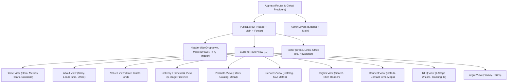
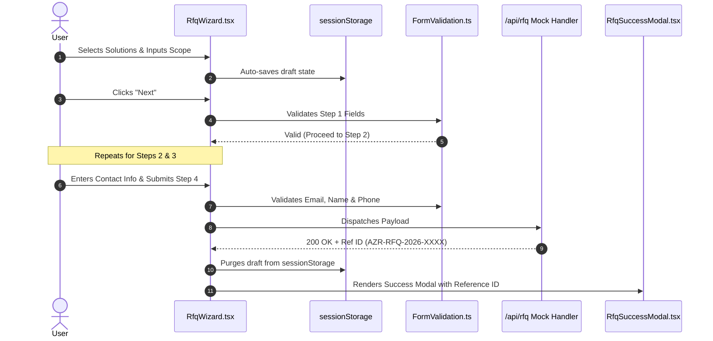

# Architecture & Minimal-Change Implementation Plan

**Project:** Azaroth UI  
**Phase:** Phase 2 — Architecture and Implementation Plan  
**Target Architecture:** Modern Vite + TypeScript + Modular Vanilla CSS Architecture  
**Date:** 2026-10-11  
**Status:** Ready for Stakeholder Review (Pre-Implementation Checkpoint)  

---

## 1. Executive Summary & Architectural Foundation

This document defines the architectural specifications and file-by-file implementation plan for the **Azaroth UI** platform. Grounded in the Phase 0 baseline audit and Phase 1 reference inspection of `https://azaroth-techhive.com`, this plan emphasizes:
1. **Zero Framework Bloat:** High-performance, lean runtime utilizing Vite and Vanilla TypeScript/React with Vanilla CSS design tokens.
2. **Visual & Aesthetic Excellence:** Enterprise-grade design language incorporating deep emerald (`#006C35`), dark forest (`#012411`), imperial gold gradients (`#D4AF37` to `#BF9129`), warm stone canvas (`#fafaf7`), dark obsidian mode (`#0A0F1D`), and glassmorphism.
3. **URL & Route Fidelity:** Complete preservation of all 18 canonical routes mapped from the reference platform.
4. **Resilient Data & Form Flow:** Pure client-side models with fallback mocks, `sessionStorage` draft persistence for the 4-step RFQ wizard, and offline-friendly submission queues.

---

## 2. Shared Layout & Component Ownership

### 2.1 Layout Architecture
The application implements two distinct layout containers:
* **`PublicLayout` (`src/layouts/PublicLayout.tsx`):**
  * Houses the global sticky `Header`, main content area (`<main id="main-content">`), and enterprise 4-column `Footer`.
  * Controls page scroll-lock during mobile drawer expansion and manages the subtle ambient background gradient.
* **`AdminLayout` (`src/layouts/AdminLayout.tsx`):**
  * Houses the administrative sidebar, top status bar, breadcrumbs, and operational control panels (`/admin/*`).

### 2.2 Component Hierarchy & Ownership



---

## 3. CSS Boundaries & Token Architecture

To ensure modularity and eliminate stylesheet collisions, styles follow a strict token and boundary hierarchy:

### 3.1 Design Token Directory (`src/styles/tokens.css`)
```css
:root {
  /* Brand Palettes */
  --color-primary-green: #006C35;
  --color-primary-hover: #00562a;
  --color-dark-forest: #012411;
  --color-gold-from: #D4AF37;
  --color-gold-to: #BF9129;
  
  /* Canvas & Surfaces */
  --color-canvas-bg: #fafaf7;
  --color-canvas-card: #ffffff;
  --color-canvas-dark: #0A0F1D;
  --color-surface-dark-card: rgba(18, 24, 38, 0.7);
  
  /* Borders & Dividers */
  --color-border-light: rgba(0, 0, 0, 0.08);
  --color-border-dark: rgba(255, 255, 255, 0.1);
  --color-border-gold: rgba(212, 175, 55, 0.3);
  
  /* Typography */
  --font-sans: 'Plus Jakarta Sans', system-ui, -apple-system, sans-serif;
  --font-mono: 'JetBrains Mono', ui-monospace, monospace;
  
  /* Elevation & Glass */
  --shadow-sm: 0 1px 2px 0 rgba(0, 0, 0, 0.05);
  --shadow-md: 0 4px 6px -1px rgba(0, 0, 0, 0.08), 0 2px 4px -2px rgba(0, 0, 0, 0.04);
  --shadow-xl: 0 20px 25px -5px rgba(0, 0, 0, 0.1), 0 8px 10px -6px rgba(0, 0, 0, 0.05);
  --glass-blur: blur(12px);
}
```

### 3.2 CSS Scoping Boundaries
* **`global.css`:** Reset, font loading, baseline typography, accessibility focus states.
* **`layout.css`:** Container max-widths (`1280px`, `1024px`, `768px`), grid primitives, header/footer spacing.
* **`glassmorphism.css`:** Reusable classes for translucent panels, borders, and ambient glow backdrops.
* **Component-Scoped CSS:** Form styles (`rfq.css`, `contact.css`), navigation styles (`header.css`), and framework timeline styles (`framework.css`).

---

## 4. Data & Content Models

Data structures are fully decoupled from view components into strongly typed TypeScript schemas (`src/types/index.ts`) and modular content files (`src/data/`):

### 4.1 Product Model
```typescript
export interface Product {
  id: string;
  slug: string;
  name: string;
  category: 'Enterprise AI' | 'Cloud Core' | 'Data Systems' | 'Zero-Trust Security';
  badge?: string;
  tagline: string;
  description: string;
  keyCapabilities: string[];
  techSpecs: {
    latency: string;
    concurrency: string;
    compliance: string[];
    protocols: string[];
  };
  features: string[];
}
```

### 4.2 Service & SLA Model
```typescript
export interface ServiceOffering {
  id: string;
  title: string;
  category: string;
  description: string;
  outcomes: string[];
  deliverables: string[];
}

export interface SlaTier {
  tierName: 'Standard' | 'Business' | 'Mission-Critical Enterprise';
  responseTime: string;
  availabilityTarget: string;
  leadArchitectSupport: boolean;
  dedicatedEngineeringPod: boolean;
  securityAuditsIncluded: string;
}
```

### 4.3 6-Stage Delivery Framework Model
```typescript
export interface DeliveryStage {
  stageNumber: number;
  title: string;
  tagline: string;
  duration: string;
  keyActivities: string[];
  deliverables: string[];
  qualityGates: string[];
}
```

### 4.4 RFQ & Enquiry Models
```typescript
export interface RfqDraft {
  solutionCategories: string[];
  projectScope: 'MVP / Prototype' | 'Full Scale Platform' | 'Modernization / Migration' | 'Enterprise Pod';
  targetTimeline: 'Immediate (< 1 month)' | '1 - 3 Months' | '3 - 6 Months' | 'Flexible';
  budgetRange: '$25k - $50k' | '$50k - $100k' | '$100k - $250k' | '$250k+';
  requirementsDescription: string;
  ndaRequired: boolean;
  contact: {
    fullName: string;
    workEmail: string;
    phone: string;
    companyName: string;
  };
}
```

---

## 5. Form Submission Flow & Resiliency

### 5.1 Request for Quote (RFQ) Flow


### 5.2 Contact Form & Enquiry Flow
* **Real-time Validation:** Live feedback on email format, required inputs, and character length.
* **Honeypot Shield:** Hidden spam-trap input (`website_url`) to block automated bot submissions.
* **Success Feedback:** Immediate confirmation banner with direct contact phone (`+91 6379480931`) and WhatsApp link fallback.

---

## 6. Error Handling & Resilience Strategy

1. **React Error Boundary (`src/components/common/ErrorBoundary.tsx`):** Catches rendering anomalies gracefully, offering a clean reset trigger without breaking the entire page.
2. **404 Route Fallback (`src/pages/NotFound.tsx`):** Catch-all `*` route preserving brand aesthetics and providing immediate links back to `/` and `/technology-insights`.
3. **Draft Retention:** Prevents user frustration by maintaining form state in `sessionStorage` if the user navigates away or accidentally refreshes the page.

---

## 7. Accessibility (WCAG 2.1 AA) & Performance Targets

1. **Contrast Compliance:** All text meets or exceeds 4.5:1 contrast against `#fafaf7` or `#0A0F1D`.
2. **Keyboard Traversal:** All interactive modals, mobile navigation drawers, and dropdowns support full `Tab`, `Shift+Tab`, `Escape`, and `Enter` keyboard navigation.
3. **Reduced Motion:** Automatic styling override disabling transitions and animations when `prefers-reduced-motion` is detected.
4. **Performance Target:** Lighthouse Score >= 90 across Performance, SEO, Best Practices, and Accessibility.

---

## 8. Responsive Testing Matrix & Screenshot Process

| Viewport Profile | Width × Height | Primary Focus Areas |
| :--- | :--- | :--- |
| **Mobile Standard** | `375px × 667px` | Slide-over drawer menu, single-column hero, stacked RFQ inputs, touch targets >= 44px. |
| **Mobile Large** | `414px × 896px` | Card margins, badge wrapping, bottom action bars. |
| **Tablet Portrait** | `768px × 1024px` | 2-column feature grids, metric counters alignment, table horizontal scroll hints. |
| **Desktop Baseline**| `1280px × 800px` | Full navigation dropdowns, 3-column architecture pillars, split contact layout. |
| **Desktop High-Res**| `1440px × 900px` | Max-width constraint verification (`1280px`), ambient particle density, hero spacing. |

---

## 9. File-by-File Implementation Plan

This inventory specifies every file to be created during Phase 3, avoiding any unnecessary dependencies:

### 9.1 Root & Configuration Files
| Target File | Change Type | Purpose | Dependencies |
| :--- | :--- | :--- | :--- |
| `package.json` | Create | Project manifest declaring Vite, React, TypeScript, and Lucide React. | Core runtime |
| `tsconfig.json` | Create | TypeScript compiler configuration targeting ESNext and DOM. | TypeScript |
| `tsconfig.node.json` | Create | TypeScript configuration for Vite config. | TypeScript |
| `vite.config.ts` | Create | Vite build config with path aliases (`@/*`). | Vite, `@vitejs/plugin-react` |
| `index.html` | Create | HTML shell with preconnected Google Fonts (`Plus Jakarta Sans`), SEO meta tags, and favicon links. | Vite |
| `.gitignore` | Create | Ignores `node_modules`, `dist`, `.env*`, and IDE caches. | Git |
| `.gitattributes` | Create | Normalizes text line endings across Windows and Unix. | Git |

### 9.2 Design System & Stylesheets (`src/styles/`)
| Target File | Change Type | Purpose |
| :--- | :--- | :--- |
| `src/styles/tokens.css` | Create | Complete custom property token system (emerald, gold, dark forest, glass, shadows). |
| `src/styles/global.css` | Create | Base CSS reset, typography rules, selection styling, focus states. |
| `src/styles/layout.css` | Create | Grid containers, responsive breakpoints, header/footer shells. |
| `src/styles/glassmorphism.css`| Create | Backdrop blur utilities, glowing borders, frosted card styles. |
| `src/styles/components.css` | Create | Form controls, buttons, badges, accordions, and stepper widgets. |

### 9.3 Data Models & Structured Content (`src/data/`)
| Target File | Change Type | Purpose |
| :--- | :--- | :--- |
| `src/types/index.ts` | Create | TypeScript interfaces for Products, Services, Delivery Stages, RFQs, Enquiries, Articles. |
| `src/data/productsData.ts` | Create | Complete catalog of enterprise products and technical specifications. |
| `src/data/servicesData.ts` | Create | Enterprise services, delivery pods, and SLA tier matrix data. |
| `src/data/deliveryData.ts` | Create | 6-Stage Delivery Framework stages, milestones, and quality gates. |
| `src/data/insightsData.ts` | Create | Thought leadership articles, architecture whitepapers, and case studies. |
| `src/data/companyData.ts` | Create | Chennai head office address, phone numbers, leadership profiles, core values. |

### 9.4 Reusable Common Components (`src/components/common/`)
| Target File | Change Type | Purpose |
| :--- | :--- | :--- |
| `src/components/common/Header.tsx` | Create | Sticky header, brand logo, navigation links, dropdown menus, RFQ conversion CTA. |
| `src/components/common/Footer.tsx` | Create | 4-column footer, Chennai office details, quick links, newsletter signup, legal credits. |
| `src/components/common/Button.tsx` | Create | Reusable button primitive supporting gold gradient, emerald, outline, and ghost variants. |
| `src/components/common/Card.tsx` | Create | Glassmorphic surface cards with hover elevation and border glows. |
| `src/components/common/Badge.tsx` | Create | Category tags, SLA status pills, reading time badges. |
| `src/components/common/ErrorBoundary.tsx` | Create | Application-level fault tolerance boundary. |

### 9.5 Page-Specific Components (`src/components/`)
| Target File | Change Type | Purpose |
| :--- | :--- | :--- |
| `src/components/home/Hero.tsx` | Create | High-impact hero section, ambient particle canvas, dual conversion CTAs. |
| `src/components/home/MetricsBanner.tsx` | Create | 4-column metric counter with intersection observer trigger. |
| `src/components/home/Pillars.tsx` | Create | 3-column architectural pillar cards (Velocity, Zero-Trust, Scale). |
| `src/components/home/FeaturedSolutions.tsx` | Create | Interactive showcase of flagship platforms with direct RFQ links. |
| `src/components/framework/ProcessTimeline.tsx` | Create | 6-stage interactive timeline stepper with expandable milestones. |
| `src/components/services/SlaMatrix.tsx` | Create | Tiered comparison table for enterprise SLAs and engineering pod inclusions. |
| `src/components/contact/ContactForm.tsx` | Create | Validated contact form with honeypot spam protection. |
| `src/components/rfq/RfqWizard.tsx` | Create | 4-stage guided RFQ wizard with step validation and session persistence. |
| `src/components/rfq/StepIndicator.tsx` | Create | Progress stepper visualizing Stages 1 through 4. |
| `src/components/rfq/RfqSuccessModal.tsx` | Create | Confirmation screen displaying generated reference ID (`AZR-RFQ-2026-XXXX`). |

### 9.6 Application Views & Pages (`src/pages/`)
| Target File | Change Type | Route | Purpose |
| :--- | :--- | :--- | :--- |
| `src/pages/Home.tsx` | Create | `/` | Flagship landing page. |
| `src/pages/About.tsx` | Create | `/about` | Mission, Chennai headquarters, leadership pod. |
| `src/pages/Values.tsx` | Create | `/values` | 4 core engineering principles. |
| `src/pages/DeliveryFramework.tsx` | Create | `/delivery-framework`, `/how-we-work` | 6-Stage Delivery Framework deep-dive. |
| `src/pages/Products.tsx` | Create | `/products` | Filterable product directory. |
| `src/pages/ProductDetail.tsx` | Create | `/products/:slug` | Technical specifications, latency benchmarks, RFQ trigger. |
| `src/pages/Services.tsx` | Create | `/services` | Service offerings and SLA matrix. |
| `src/pages/Portfolio.tsx` | Create | `/portfolio`, `/portfolio/:slug` | Enterprise case studies showcase. |
| `src/pages/Insights.tsx` | Create | `/technology-insights`, `/insights` | Resource Hub and article search. |
| `src/pages/InsightDetail.tsx`| Create | `/technology-insights/:slug` | Article reader with sticky table of contents and code highlights. |
| `src/pages/Connect.tsx` | Create | `/connect-with-us`, `/connect` | Office details, Google Maps link, WhatsApp trigger, contact form. |
| `src/pages/RequestQuote.tsx` | Create | `/request-for-quote`, `/rfq` | 4-step RFQ wizard flow. |
| `src/pages/PrivacyPolicy.tsx`| Create | `/privacy-policy` | Enterprise privacy statement. |
| `src/pages/TermsOfService.tsx`| Create | `/terms-of-service` | Platform terms of service. |
| `src/pages/NotFound.tsx` | Create | `*` | Custom 404 page with navigation links. |

### 9.7 App Entry & Router
| Target File | Change Type | Purpose |
| :--- | :--- | :--- |
| `src/App.tsx` | Create | Router configuration mapping all 18 routes, route redirects, and public layout shell. |
| `src/main.tsx` | Create | React DOM mount entry loading `global.css` and `tokens.css`. |

---

## 10. Release, Checkpoint & Rollback Strategy

1. **Phase 2 Exit:** Submit this implementation plan for stakeholder review before scaffolding.
2. **Phase 3 Atomic Milestones:**
   * *Milestone 3.1:* Project scaffolding & configuration (`package.json`, `vite.config.ts`, `tokens.css`, `index.html`).
   * *Milestone 3.2:* Core layouts & navigation (`Header`, `Footer`, `PublicLayout`, `App.tsx`).
   * *Milestone 3.3:* Marketing & Content pages (`Home`, `About`, `Values`, `DeliveryFramework`, `Portfolio`).
   * *Milestone 3.4:* Product & Service catalogs with SLA comparison (`Products`, `ProductDetail`, `Services`).
   * *Milestone 3.5:* Interactive Resource Hub & Insights reader (`Insights`, `InsightDetail`).
   * *Milestone 3.6:* Conversion portals (`Connect`, `RequestQuote` 4-stage wizard).
3. **Rollback Safety:** Every milestone will be committed as an atomic Git checkpoint on `main`. In the event of a breaking regression, the system can instantly revert to the preceding milestone commit (`git reset --hard HEAD~1` or branch rollback).
